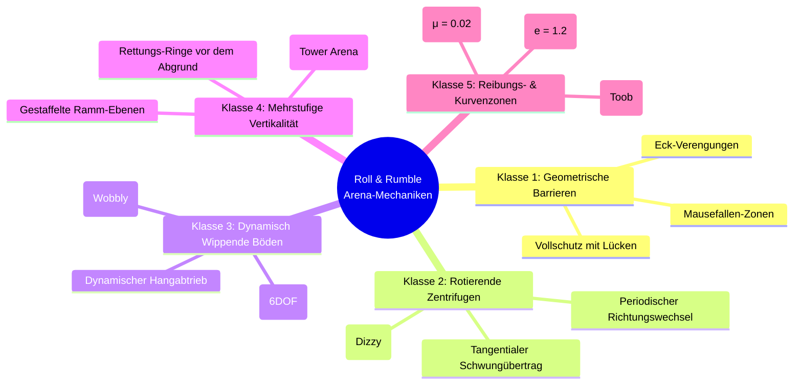

# Ausbaukonzept: Arena-Katalog & Dynamische Mechaniken (Roll & Rumble 3D)

> **Dokument:** Ausbau- und Feature-Konzept (Roadmap Phase 2–4)  
> **Projekt:** Roll & Rumble 3D (`artifacts/consumers/production/godot/gd-godot-roll-and-rumble`)  
> **Inspiration & Analyse:** Hamsterball Rodent Rumble Arenas ([Hamsterball Fandom Wiki](https://hamsterball.fandom.com/wiki/Category:Hamsterball_Arenas))  
> **Standard:** Spec-Driven Intent-Engineering nach Vorlesung *07: Agentic Game Development*

---

## 1. Executive Summary & Ziel

Im Phase-1-Prototyp wurde der minimale physikalische Core Loop mit einer statischen Zylinderplattform, Newtonscher Starrkörperphysik (`RigidBody3D`), Shared Camera und Mausefallen-Hazards implementiert und automatisiert getestet.

Dieses Ausbaukonzept formalisiert die **systematische Erweiterung um 8 unverwechselbare Arenen**, basierend auf der Level-Architektur des historischen Vorbilds *Hamsterball*, adaptiert für modernes Indie-Game-Design in Godot 4.

---

## 2. Die 5 physikalischen Mechanik-Klassen

Die Analyse der 15 Original-Arenen aus *Hamsterball* (Beginner, Dizzy, Wobbly, Tower, Glass, Toob, Up, Master etc.) offenbart **fünf distinkte physikalische Mechanik-Klassen**:



---

## 3. Der 8-Arenen-Katalog für Roll & Rumble 3D

| Nr. | Arena-Name | Vorbild / Archetyp | Primäre Mechanik & Dynamik | Risiko / K.O.-Gefahr |
| :--- | :--- | :--- | :--- | :--- |
| **01** | **Beginner Ring** | *Beginner Arena* | Zylindrische Plattform mit 4 breiten Schutzbanden; 4 offene K.O.-Gassen. | Gering (Ideal zum Einstieg) |
| **02** | **Mousetrap Cross** | *Intermediate Arena* | Kreuzförmige Arena mit 4 Schnapp-Mausefallen auf den Trittplatten der Kanten. | Hoch (Katapult-Gefahr) |
| **03** | **Dizzy Spinner** | *Dizzy Arena* | Große rotierende Mittelscheibe; wechselt alle 8 s die Drehrichtung. | Mittel (Zentrifugalkraft) |
| **04** | **Wobbly Seesaw** | *Wobbly Arena* | Die gesamte Plattform ist mittig kardanisch gelagert und kippt bei Belastung! | Extrem (Schwerkraft-Hangabtrieb) |
| **05** | **Citadel Tower** | *Tower Arena* | 3-stufiger Turm ($Y = +4\,\text{m}, +2\,\text{m}, 0\,\text{m}$). Sturz nach unten landet auf unterer Stufe! | Gestaffelt (Vertikale Taktik) |
| **06** | **Glass & Neon** | *Glass / Neon Arena* | Eisglatter Glasboden ($\mu = 0.05$) mit 4 Neon-Bumpern ($e = 1.25$ Super-Bounce). | Hoch (Unkontrolliertes Schleudern) |
| **07** | **The Halfpipe** | *Toob Arena* | U-förmige Arena mit steilen Seitenwänden für Beschleunigung und Looping-Rammen. | Mittel (Pendel-Action) |
| **08** | **Crumbling Pit** | *Sudden Death Arena* | Plattform zerbröckelt ringförmig alle 15 Sekunden; Zentrum bleibt übrig. | Maximal (Schrumpfende Zone) |

---

## 4. Detaillierte Spezifikation der 4 komplexen Schlüssel-Arenen

### 4.1 Arena 03: *Dizzy Spinner* (Zentrifugale Drehscheibe)
- **Architektur in Godot 4:**
  - Außenring (`StaticBody3D`): Fester Randbereich mit leicht erhöhtem Grip ($\mu = 0.7$).
  - Innenscheibe (`AnimatableBody3D`): Radius $6\,\text{m}$, rotiert kontinuierlich um die Y-Achse:
    $$\omega(t) = \Omega_{\max} \cdot \cos\left(\frac{2\pi t}{T_{\text{period}}}\right)$$
- **Physikalischer Effekt:**
  - Kugeln auf der Drehscheibe erfahren die Zentrifugalkraft $\vec{F}_{\text{zentrifugal}} = m \cdot \omega^2 \cdot \vec{r}$.
  - Bei hoher Drehzahl werden passive Kugeln automatisch an den Rand geschleudert.
  - Aktives Mitrollen in Drehrichtung verleiht massiven Extra-Schwung für Rammstöße!

---

### 4.2 Arena 04: *Wobbly Seesaw* (Dynamische Kipp-Plattform)
- **Architektur in Godot 4:**
  - Basis-Säule (`StaticBody3D`) im Zentrum.
  - Wipp-Plattform (`RigidBody3D` oder über `Generic6DOFJoint3D` angebunden):
    - Drehung um $X$ und $Z$ freigegeben (Winkelbegrenzung max. $\pm 18^\circ$).
    - Rückstellfeder (`angular_limit_x/softness = 0.5`, `spring = true`).
- **Gameplay-Dynamik:**
  - Rollen zwei Spieler auf dieselbe Seite, neigt sich die Arena gefährlich nach unten.
  - Alle Kugeln rutschen durch den Hangabtrieb $\vec{F}_H = m \cdot \vec{g} \cdot \sin(\alpha)$ talwärts.
  - Wer den Scheitelpunkt (die Mitte) kontrolliert, dominiert die Arena.

---

### 4.3 Arena 05: *Citadel Tower* (Mehrstufiger Vertikal-Turm)
- **Architektur in Godot 4:**
  - **Oberste Ebene (Level 3):** Kleiner Kreis (Radius $3\,\text{m}$), $Y = +3.5\,\text{m}$. Wer hier steht, kann Gegner nach unten schmettern.
  - **Mittlere Ebene (Level 2):** Ring (Radius $7\,\text{m}$), $Y = +1.8\,\text{m}$.
  - **Basis-Ebene (Level 1):** Großer Ring (Radius $11\,\text{m}$), $Y = 0\,\text{m}$.
  - Erst ein Sturz unter $Y = -4.0\,\text{m}$ löst den Out-of-Bounds Trigger aus!
- **Gameplay-Vorteil:**
  - Schafft vertikale Ramm-Mechanik: Schläge von oben nutzen die Fallgeschwindigkeit $v_y$ für verheerende Impulse.

---

### 4.4 Arena 08: *Crumbling Pit* (Schrumpfende Battle-Royale-Arena)
- **Architektur in Godot 4:**
  - Aufgeteilt in 3 konzentrische Kachel-Ringe:
    - Äußerer Ring (Radius $12\,\text{m}$ bis $9\,\text{m}$): Blinkt nach 15 s rot und stürzt nach 20 s physikalisch ab.
    - Mittlerer Ring (Radius $9\,\text{m}$ bis $5\,\text{m}$): Stürzt nach 40 s ab.
    - Kern (Radius $5\,\text{m}$): Verbleibt für das finale Duell bis zum Match-Ende.
- **Gameplay-Vorteil:**
  - Löst das Problem von „Campern“ am Rand und erzeugt automatisch dramatische Finales.

---

## 5. Implementierungs-Roadmap & Modulare Szenenstruktur

```text
gd-godot-roll-and-rumble/
├── docs/
│   └── gdd/
│       ├── MICRO_GDD.md         (Phase 1 Baseline)
│       └── EXPANSION_ARENAS.md  (Dieses Dokument)
├── scenes/
│   ├── arenas/
│   │   ├── arena_01_beginner.tscn
│   │   ├── arena_02_mousetrap.tscn
│   │   ├── arena_03_dizzy.tscn
│   │   ├── arena_04_wobbly.tscn
│   │   ├── arena_05_tower.tscn
│   │   ├── arena_06_glass.tscn
│   │   ├── arena_07_halfpipe.tscn
│   │   └── arena_08_crumbling.tscn
│   ├── main.tscn
│   └── ui_arena_select.tscn
```

### Turniermodus (Tournament / Party Play):
- Best of 5 Matches: Nach jedem Durchgang wechselt die Arena zufällig oder per Voting.
- Highscore & Trophäen-Tabelle am Ende der Runde.
