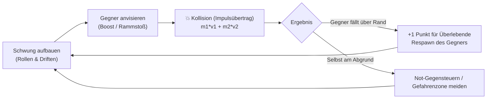

# Micro-GDD: Roll & Rumble (Godot 4 3D)

> **Standard:** Micro Game Design Document nach Vorlesung *07: Agentic Game Development*  
> **Projekt:** Roll & Rumble (Godot 4 3D)  
> **Ziel-Engine:** Godot Engine 4.x (Forward+ / Mobile)  
> **Zielordner:** `artifacts/consumers/production/godot/gd-godot-roll-and-rumble`  
> **Status:** Phase 1 Spezifikation (Scaffolding & Core Loop)

---

## 1. High Concept
*Roll & Rumble* ist ein rasantes 3D-Bumper-Sumo-Partyspiel für 2 bis 4 Spieler, bei dem physikalisch simulierte Kugeln auf einer schwebenden Arena gegeneinander antreten, um sich gegenseitig über den Rand in den Abgrund zu katapultieren.

---

## 2. Core Loop (5–10 Sekunden)

---

## 3. Controls & Input

| Aktion | Spieler 1 (Keyboard) | Spieler 2 (Keyboard) | Spieler 3 & 4 (Gamepad) |
| :--- | :--- | :--- | :--- |
| **Bewegung ($X/Z$)** | `W`, `A`, `S`, `D` | Pfeiltasten (`↑`, `←`, `↓`, `→`) | Linker Analogstick / D-Pad |
| **Boost / Rammstoß** | `Space` | `Enter` | Button A / Bottom Action |
| **Bremse / Grip** | `Shift` | `Rechtes Strg` | Button B / Trigger |
| **Pause / Reset** | `P` / `R` | `P` / `R` | Start-Button |

---

## 4. State Space & Entities

### 4.1 Entities
1. **Bumper Ball (`RigidBody3D`):**
   - Kugel-Radius: $0.6\,\text{m}$, Masse: $3.0\,\text{kg}$.
   - Physik-Material: `bounce = 0.75`, `friction = 0.5`.
   - Zustände: `Spawning`, `Active`, `Boosting`, `Falling`, `Out`.
2. **Arena (`StaticBody3D`):**
   - Schwebende zylindrische oder hexagonale Plattform (Radius $12\,\text{m}$).
   - Reibung: $0.6$ (Mitte), $0.05$ (Eis-Randbereiche).
3. **Mausefalle / Hazard (`StaticBody3D` + `Area3D`):**
   - Schnappt bei Überrollen zu und verleiht vertikalen Impuls ($+25\,\text{m/s}$ nach oben).
4. **Out-of-Bounds Trigger (`Area3D`):**
   - Große Ebene unterhalb der Arena ($Y = -5\,\text{m}$), erkennt herabstürzende Kugeln.

### 4.2 State Space des Matches
- `COUNTDOWN` (3.. 2.. 1.. GO!)
- `PLAYING` (Match-Timer läuft von 60 s herunter)
- `SUDDEN_DEATH` (bei Punktegleichstand nach 60 s: nächster Fall entscheidet)
- `MATCH_OVER` (Siegerehrung, Konfetti, Replay-Prompt)

---

## 5. Win/Loss & Scoring

- **Punktevergabe:**
  - Fällt ein Spieler über den Arenarand in den Abgrund, erhalten **alle noch auf der Plattform verbleibenden Spieler** je $+1$ Punkt.
  - Hat ein Spieler den Gefallenen innerhalb der letzten 1.5 Sekunden aktiv gerammt, erhält dieser Spieler zusätzlich $+1$ Extrapunkt („Smash KO“).
- **Match-Ende:**
  - Nach Ablauf des 60-Sekunden-Timers gewinnt der Spieler mit den meisten Punkten.
  - Bei Gleichstand: *Sudden Death* auf schrumpfender Arena!

---

## 6. Architekturvorgaben (Godot 4)

- `scripts/config.gd`: Zentral isolierte Physik- und Matchparameter.
- `scripts/state_manager.gd`: Deterministische Match-State-Machine.
- `scripts/player_ball.gd`: `RigidBody3D`-Steuerung mit Kraft- und Drehmoment-Methoden.
- `scripts/shared_camera.gd`: Dynamische Schwerpunkt- und Bounding-Box-Kamera.
- `test_gameplay.gd`: Headless Test-Runner für CI/CD (`godot --headless -s test_gameplay.gd`).
