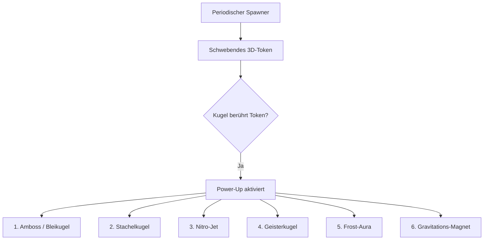

# Konzept: Power-Up-System & Roadmap (Roll & Rumble 3D)

> **Dokument:** Power-Up Spezifikation & Zukünftige Roadmap  
> **Projekt:** Roll & Rumble 3D (`artifacts/consumers/production/godot/gd-godot-roll-and-rumble`)  
> **Kategorie:** Game Feel & Emergent Gameplay  
> **Standard:** Spec-Driven Intent-Engineering nach Vorlesung *07: Agentic Game Development*

---

## 1. Übersicht & Spielmechanisches Ziel

Um neben der physikalischen Arena-Dynamik (Zentrifugen, Wippen, Flipper-Bumper, Glatteis) zusätzliche taktische Tiefe und Wendepunkte (Comeback-Mechaniken) zu schaffen, wird ein modulares **Power-Up-System** spezifiziert.

### Grundregeln:
* **Spawn-Punkte:** Power-Ups spawnen periodisch (alle 12–18 Sekunden) als schwebende, rotierende 3D-Tokens im Zentrum oder an risikoreichen Kanten der Arena.
* **Aktivierung:** Berührung durch eine `PlayerBall`-Instanz (`body_entered` auf `Area3D`) aktiviert den Effekt sofort.
* **Dauer:** Zeitlich begrenzte Effekte halten 6–8 Sekunden an; optisches Feedback erfolgt über Kugel-Shader/Materialwechsel und Partikel-Auren.
* **Stacking:** Ein neues Power-Up überschreibt das aktive Power-Up des Spielers.

---

## 2. Die 6 Power-Up-Archetypen

### 1. 🪨 Amboss / Bleikugel (`Anvil / Heavy Iron`)
* **Effekt:** Die Masse der Kugel verdreifacht sich temporär ($m = 3 \times m_0$), Dämpfung und Reibung steigen.
* **Vorteil:** Immun gegen gegnerische Rammstöße und Bumper; schiebt alle anderen Kugeln wie eine Dampfwalze vom Ring.
* **Nachteil:** Trägere Beschleunigung und schwerer auf der Wippe auszubalancieren.
* **Visuelles Feedback:** Dunkles Gusseisen-PBR-Material mit metallischem Klingen bei Aufprall.

### 2. ⚡ Stachelkugel (`Spike Wheel / Super Punch`)
* **Effekt:** Kugel erhält spitze rotierende Dornen; Stoßimpuls bei Kollisionen verdoppelt sich ($Impuls \times 2.0$).
* **Vorteil:** Jeder Rammkontakt katapultiert getroffene Gegner mit massiver Wucht direkt in Richtung Rand.
* **Visuelles Feedback:** Rote Warn-Emission, kreisförmige Stachel-Mesh-Instanzen, starkes Kamera-Trauma ($0.65$).

### 3. 🚀 Nitro-Jet (`Triple Turbo Boost`)
* **Effekt:** Gewährt sofort 3 aufeinanderfolgende Super-Boosts ohne Cooldown-Wartezeit.
* **Vorteil:** Extrem schneller Richtungswechsel, rettet vor Stürzen über die Kante und ermöglicht Überraschungsangriffe quer durch das Zentrum.
* **Visuelles Feedback:** Blauer Plasma-Schweif und zweistufige CPUParticles3D-Triebwerksflammen am Heck.

### 4. 👻 Geisterkugel (`Ghost Phase`)
* **Effekt:** Die Kugel wechselt ihre Physik-Ebene (`collision_mask`); rollt 4 Sekunden lang berührungslos durch gegnerische Kugeln, Bumper und Mausefallen hindurch.
* **Vorteil:** Perfekt zum Entkommen aus brenzligen Ecksituationen oder zum Überqueren gefährlicher Zentrifugen.
* **Visuelles Feedback:** Halbtransparentes cyanfarbenes Glasmaterial mit pulsierendem Fresnel-Leuchten.

### 5. ❄️ Frost-Aura (`Ice Trail / Freeze`)
* **Effekt:** Die Kugel hinterlässt für 6 Sekunden eine glatteisige Rutschspur auf der Plattform.
* **Vorteil:** Gegner, die in die Spur geraten, verlieren jegliche Haftung (`friction \to 0.01`) und driften unkontrolliert ab.
* **Visuelles Feedback:** Frost-Partikel und temporäre Eis-Decals auf dem Arena-Boden.

### 6. 🧲 Gravitations-Magnet (`Gravity Singularity`)
* **Effekt:** Erzeugt ein lokales Anziehungsfeld um die eigene Kugel ($Radius = 4\,\text{m}$).
* **Vorteil:** Gegner können aktiv zum Rand gezogen oder bei einem eigenen waghalsigen Manöver mitgerissen werden.
* **Visuelles Feedback:** Violette rotierende Gravitationsringe und subtiler Raumkrümmungs-Shader.

---

## 3. Zukünftige Roadmap (Roll & Rumble 3D)

* [x] **Phase 1: Minimaler Physik-Prototyp:** Zylinderplattform, Starrkörperphysik, Mausefallen, 4-Spieler-Lobby, KI-Steering.
* [x] **Phase 2: Arena-Modularität & Dynamik:** `BaseArena`-Architektur, Zentrifuge (`DizzySpinner`), Wippe (`WobblySeesaw`), Flipper-Bumper (`BumperPinball`), Glatteis (`IceSlick`).
* [x] **Phase 2.5: PBR-Texturen & Juiciness:** Fischgrät-Parkett, Hazard-Rotor, Riffelblech, Kosmisches 360°-Himmelspanorama, prozedurale Audio-Synthese, CPUParticles3D-Funken, Trauma-Screenshake.
* [ ] **Phase 3: Power-Up System:** Spawner-Klasse, 3D-Pickup-Tokens, Status-Effekt-Pipeline in `PlayerBall`.
* [ ] **Phase 4: Weitere Arenen aus Expansion-Katalog:** `Citadel Tower` (3-Stufen-Turm), `Halfpipe Toob` (U-Röhre), `Crumbling Pit` (zerbröckelnde Plattform).
* [ ] **Phase 5: Turnier-Modus & Best-of-5:** Rundenwertung, Arena-Voting in der Lobby, Siegerehrungspodest.
